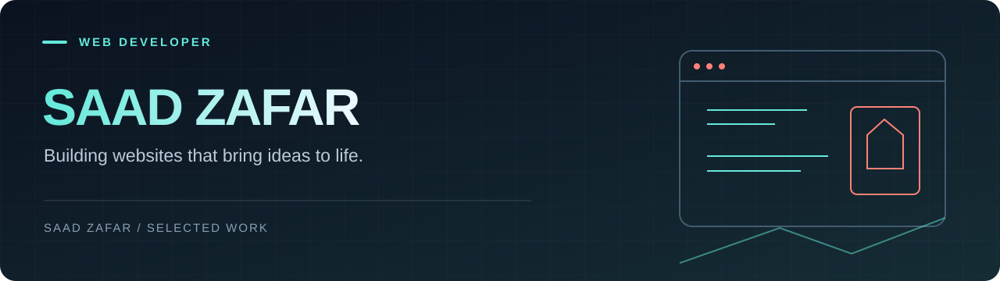

  

## Hey, I'm Saad.

I build websites that turn an idea into something people can explore and use. My work includes a property marketplace I built independently and an event website I built with a team as IT Lead.

## Selected work

### 01 · PyaraSaGhar

**Property marketplace · Sole designer & developer**

A connected property platform for Pakistan, bringing property listings, brokers, developers, construction materials, and buyer requirements together.

**My contribution:** I designed and built the entire website independently.

**[Visit website ↗](https://pyarasaghar.com/)** · **[Explore project showcase →](https://github.com/Saad-Zafar1/pyarasaghar-showcase)**

---

### 02 · TEDxUMT Lahore

**Event website · IT Lead & development team member**

A digital home for TEDxUMT Lahore, with event information, team pages, a gallery, sponsors, and application entry points.

**My contribution:** I served as IT Lead and built the website alongside two other team members. This was a shared, three-person development effort.

**[Visit website ↗](https://tedxumtlahore.vercel.app/)** · **[Explore project showcase →](https://github.com/Saad-Zafar1/tedx-umt-showcase)**

---

### What I bring to a project

- **Independent delivery:** taking a website from idea to a finished experience.
- **Product thinking:** organizing content and navigation around what visitors need.
- **Collaboration:** building with others and contributing as an IT Lead.

Selected real-world work. Project showcases include screenshots, live links, and contribution details; website source code is not published here.

